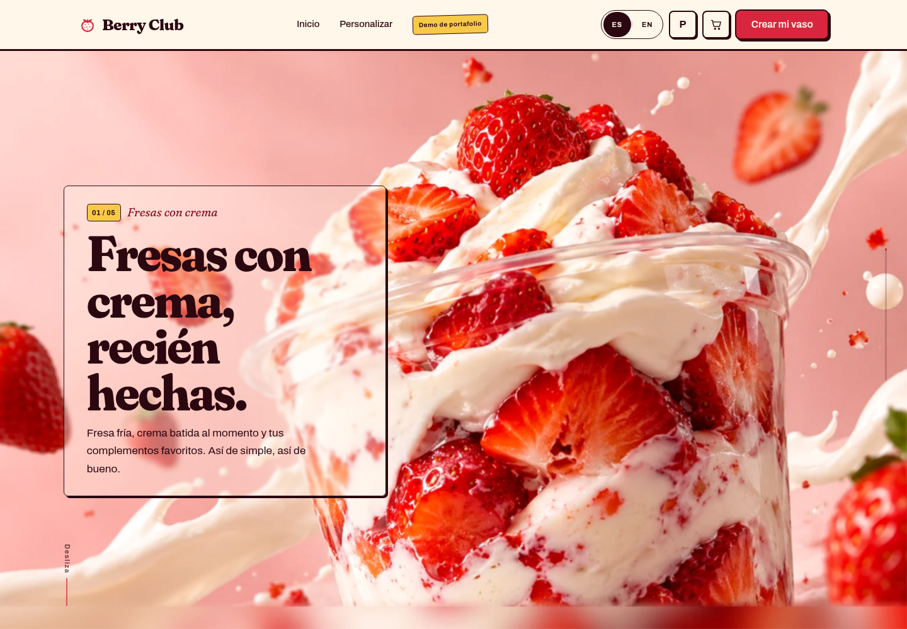
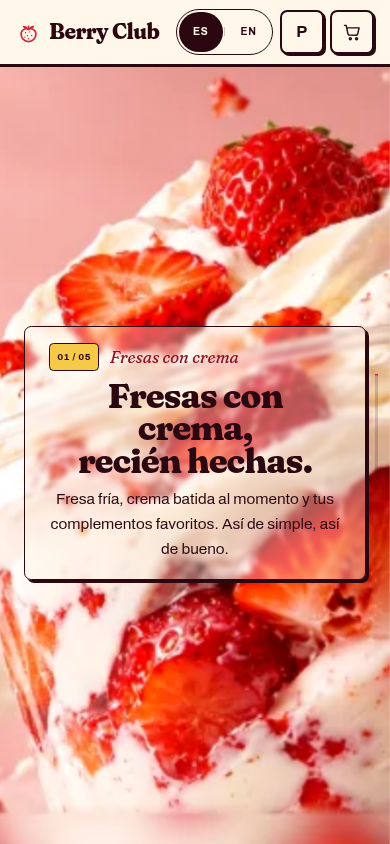
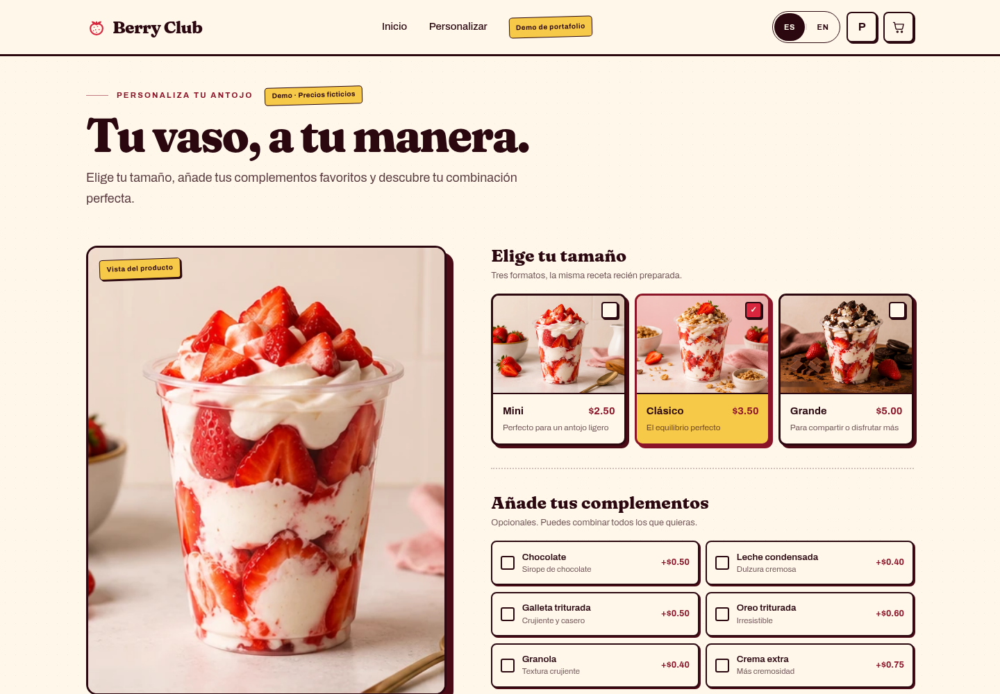
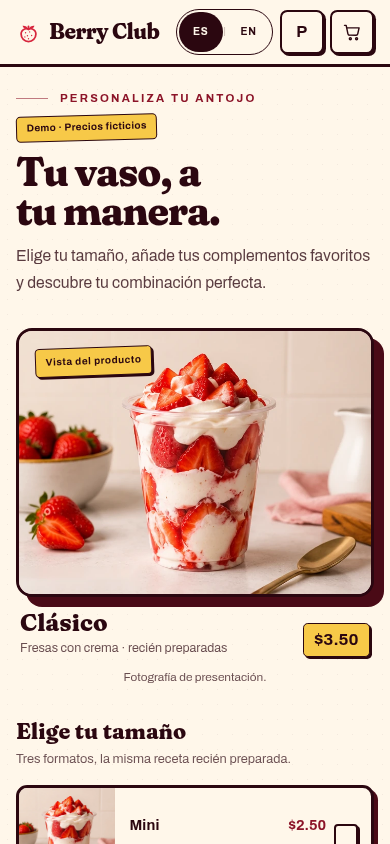
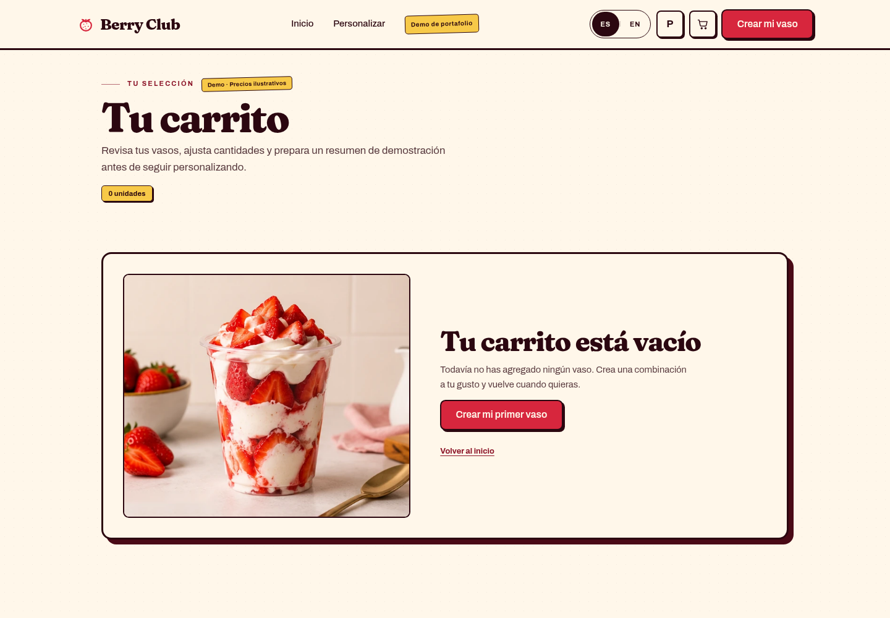
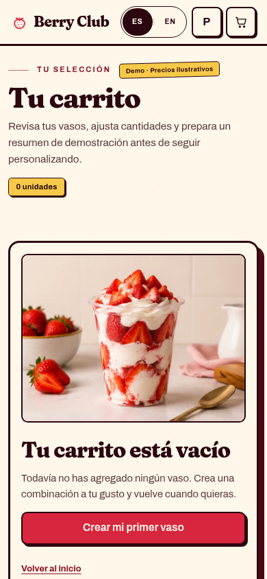

# Berry Club - Demo de Portafolio Frontend

Berry Club es una **demo de portafolio de puro frontend** para una marca ficticia de fresas con crema. No tiene backend, ni base de datos, ni servidor propio. Es solo código HTML, CSS y JavaScript vanilla.

## Qué incluye
- Portada inmersiva con fotografía de producto
- Personalizador de producto (tamaños, complementos, cantidad)
- Carrito persistente en `localStorage` del navegador
- Cambio de idioma español/inglés (ES/EN)
- Diseño responsivo (móvil, tablet y escritorio)
- Diseño visual propio (tipografía Fraunces + Archivo, bordes de tinta, sombras duras)

## Qué NO incluye (por el momento)
- ❌ Backend o servidor
- ❌ Base de datos
- ❌ Pagos reales o pasarela de pago
- ❌ Formulario de contacto con envío de correo
- ❌ Panel de administración
- ❌ Persistencia en la nube (el carrito solo vive en el navegador de cada usuario)

## Cómo ejecutar

El proyecto usa módulos ES, por lo que debe servirse por HTTP. Abrir los archivos con `file://` no funciona.

### Con Python
```bash
python3 -m http.server 8000
```
O en Windows:
```bash
python -m http.server 8000
```
Luego abre `http://localhost:8000/`.

### Con Node.js
```bash
npx http-server -p 8000
```
O instálalo globalmente:
```bash
npm install -g http-server
http-server -p 8000
```

### Con VS Code (Live Server)
1. Abre la carpeta `berry-club` en VS Code.
2. Instala la extensión **Live Server** (Ritwick Dey).
3. Haz clic en **"Go Live"** en la barra inferior o presiona `Alt + L`, `Alt + O`.
4. Se abrirá automáticamente en `http://127.0.0.1:5500/`.

## Capturas

| Portada (desktop) | Portada (móvil) |
|---|---|
|  |  |

| Pedido (desktop) | Pedido (móvil) |
|---|---|
|  |  |

| Carrito (desktop) | Carrito (móvil) |
|---|---|
|  |  |


